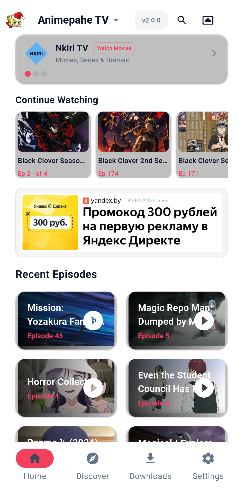
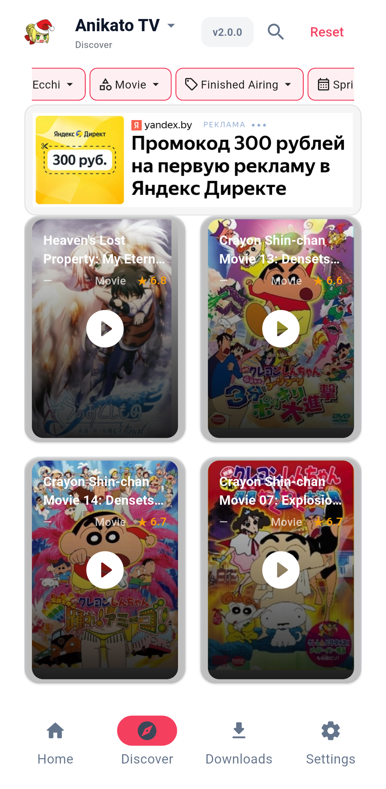
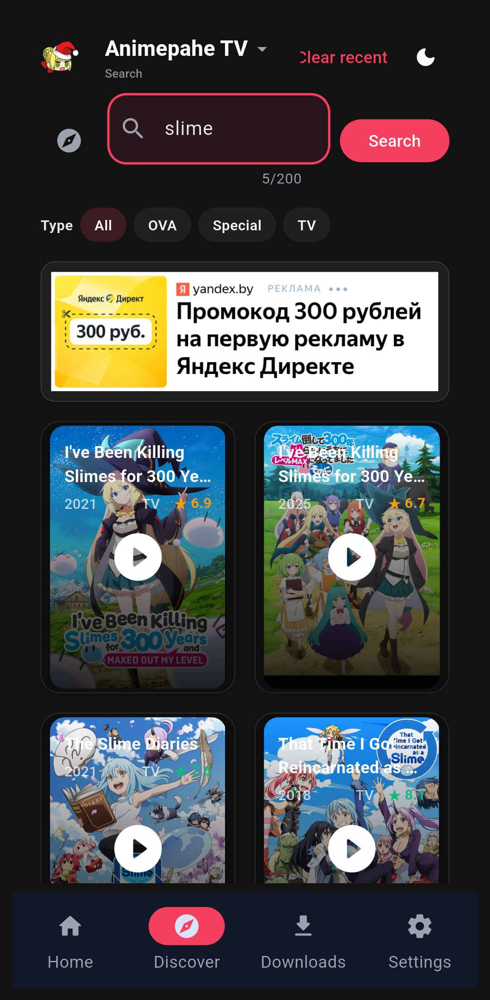
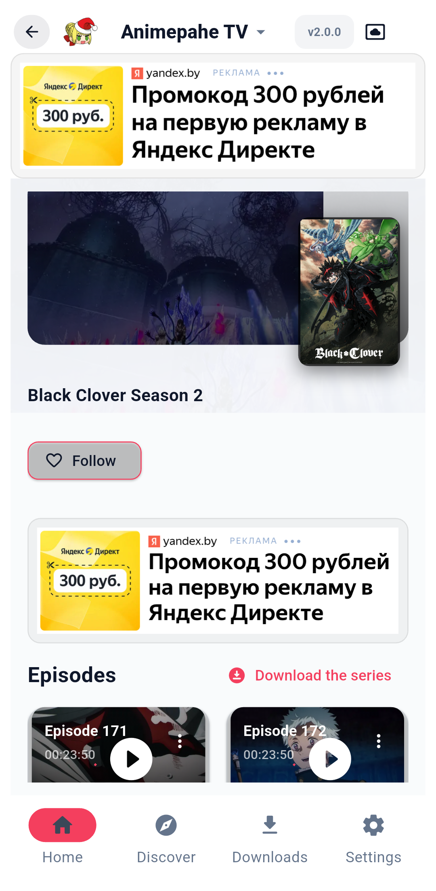
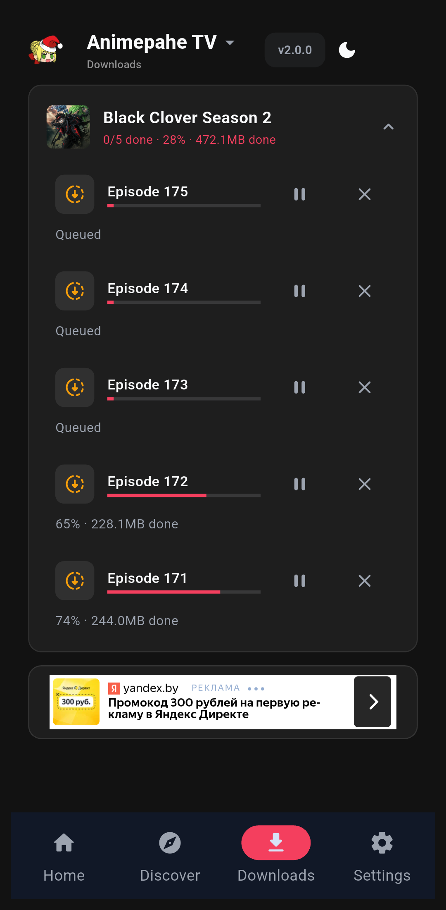
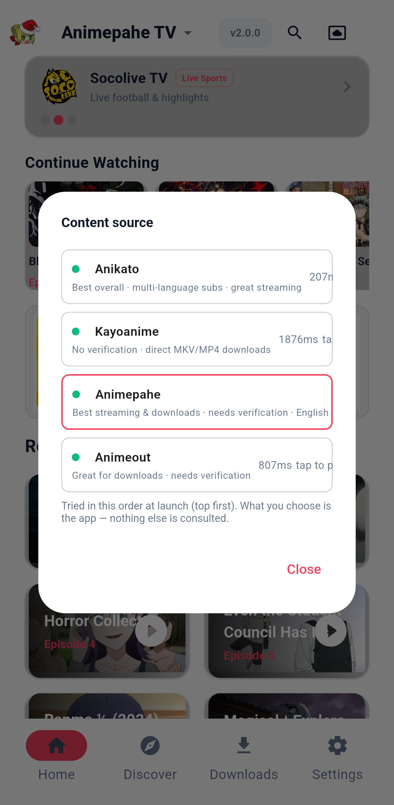
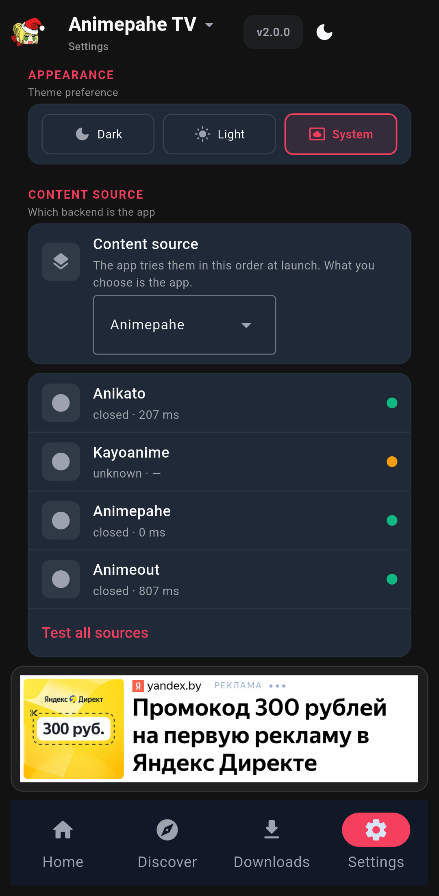

<p align="center">
  
</p>

<h1 align="center">AnimePahe TV</h1>

<p align="center">
  A high-performance, client-side anime streaming application with TV-optimized navigation,
  multi-quality stream resolution, and a responsive glassmorphic UI — a hybrid of independent
  sources, one chosen at startup and treated as the whole app.
</p>

<p align="center">
  
  
  <br>
  
  
</p>

---

## Download

Get the latest version of AnimePahe TV. Modern phones and TVs use the **ARM64** APK.

| Platform | Download | Size | Notes |
|:--------:|:--------:|:----:|:------|
| 🤖 **Android (ARM64)** | [**animepahe-tv-arm64-v8a.apk**](https://github.com/Nwokike/animepahe-tv/releases/latest/download/animepahe-tv-arm64-v8a.apk) | ~42 MB | For modern 64-bit Android TVs and smartphones |
| 🤖 **Android (ARM32)** | [**animepahe-tv-armeabi-v7a.apk**](https://github.com/Nwokike/animepahe-tv/releases/latest/download/animepahe-tv-armeabi-v7a.apk) | ~41 MB | For older 32-bit Android devices and older Firesticks |
| 🤖 **Android (x86_64)** | [**animepahe-tv-x86_64.apk**](https://github.com/Nwokike/animepahe-tv/releases/latest/download/animepahe-tv-x86_64.apk) | ~44 MB | For Android emulators / ChromeOS |
| 📦 **Android (Universal)** | [**animepahe-tv.apk**](https://github.com/Nwokike/animepahe-tv/releases/latest/download/animepahe-tv.apk) | ~100 MB | One APK for **every device** — all architectures in a single install |

APK download size is kept small with `legacy_packaging = true` in `pyproject.toml` (native libraries stored compressed in the APK; since Flet 0.86 they default to uncompressed, which doubles the download).

---

## Screenshots

| Home | Discover | Search |
|:----:|:--------:|:------:|
|  |  |  |

| Anime Detail | Downloads | Source Picker |
|:------------:|:---------:|:-------------:|
|  |  |  |

| Settings |
|:--------:|
|  |

---

## Features

- **Independent sources, one at a time** — four backends (AniKato, Kayoanime,
  AnimePahe, AnimeOut — in that order, by what each one COSTS the user: the
  first two answer with no verification, AnimePahe's catalogue is
  Cloudflare-gated, AnimeOut's file host is walled), each with its own
  catalog, artwork, playback and Cloudflare story. The app resolves
  one source behind a startup splash (a stored pin, or the fixed order
  AniKato → Kayoanime → AnimePahe → AnimeOut) and
  then *is* that source: nothing else is consulted, and switching re-runs the whole gate.
- **The art decides the layout** — the screen sniffs the shape of the artwork the active source
  serves and paints itself in landscape or portrait automatically: grids, shelves and cards all
  swap. There is no layout setting, by design.
- **Browse & Search** — submit-driven search with debounced recent-search suggestions, paginated
  results, and real empty/error states.
- **Continue Watching** — a shelf on Home that picks up exactly where you stopped; positions
  persist across launches.
- **In-app Player** — `flet-video` (mpv) with a quality selector when the master playlist offers
  variants, resume from your saved position, next/previous episode buttons, subtitles (including
  offline sidecars saved with downloads), a 20s-network-timeout watchdog so a dead stream fails into
  Retry instead of hanging, SafeArea-aware controls, and a single Back path that exits fullscreen
  and closes in one press.
- **Offline Downloads** — save any episode (or a whole series) for offline: parallel segments,
  `Range`-resumable, cancel-safe, grouped by series with live MB progress (verified totals for
  direct-file sources), a 1–2 concurrent-jobs setting, and honest "Interrupted — tap Resume" state
  after the app is killed mid-download. Downloaded episodes play from the same player with resume
  intact, and tapping an episode that is already downloaded plays the local file.
- **Notifications** — `flet-notifications`: new episodes of followed anime, download progress and
  completion, and update alerts; taps route into the app. The screen stays awake (wake lock) while
  the player is open or downloads run.
- **Live Activity Terminal** — Settings → Open Terminal: the last 500 engine/network/UI log lines
  with telemetry, for diagnosing Cloudflare/CDN/download issues.
- **TV Remote Navigation** — D-pad focus with per-state focus rings, one focus manager routing
  Back/Escape; navigation rail on TV and wide screens, bottom bar on phones.
- **Persistent Cloudflare sessions** — a solved clearance is stored durably per host and re-probed
  before use, so returning boots skip the verification window; AnimePahe's turnstile appears only
  when AnimePahe is the chosen source.
- **System Theme Awareness** — Dark → Light → System cycling.
- **Storage done by tier** — durable data, regenerable cache and throwaway temp resolve through one
  module (`core/storage.py`) against `FLET_APP_STORAGE_*`, matching how a packaged app behaves on a
  device.

## Architecture

| Layer | Technology |
|-------|-----------|
| Frontend | Flet 1.1.0.dev3 (Python → Flutter), `@ft.component` screens |
| Video Engine | `flet-video` 1.1.0.dev3 (mpv backend) |
| Network | `primp` 2.0.1 (async, Chrome impersonation for Cloudflare, `Range`-capable streaming) |
| Sources | Provider protocol + `ProviderRouter` (breaker per provider, owner-scoped catalog ops, health in Settings) |
| Cloudflare | `flet-webview` on Android/iOS (Android TV falls back to the desktop solver); pywebview subprocess for desktop dev |
| Notifications | `flet-notifications` 1.1.0.dev3 (channels, in-place progress, tap routing) |
| Durable state | Atomic JSON in the data tier (`FLET_APP_STORAGE_DATA`): history, continue watching, positions, clearance, downloads, artwork defaults |
| Stream resolution | Per-source: AniKato's encrypted MegaPlay manifests, AnimePahe's Kwik unpack, Kayoanime's Drive, AnimeOut's DDL chain (files walled) |
| Artwork | `core/artwork.py` (byte sniffing) + `services/artwork_probe.py` (cache-first range probes) |
| Ads | `flet-yandex-ads` |
| State Management | `@observable` AppState + context providers + a controller bridge |
| Navigation | Component-state branches (tabs / detail / player), rail/bar adaptive |
| Diagnostics | In-memory ring-buffer log handler → Activity Terminal |
| Storage | No Android permissions needed — app-private dirs only |

### Project Structure

```text
src/
├── main.py                    # AppController (services + data actions + startup resolve) + entry
├── app_shell.py               # Adaptive shell: rail/bottom nav, splash, tab + detail + player branches
├── state/
│   ├── app_state.py           # AppStateCtx = ft.create_context(state)
│   └── controller_ctx.py      # ControllerMethods bridge
├── screens/
│   ├── home_screen.py         # Promo hero, continue watching, latest grid, banners
│   ├── search_screen.py       # Submit-driven search + suggestions + pager
│   ├── discover_screen.py     # Filtered browse for sources that serve one
│   ├── anime_detail_screen.py # Backdrop, poster, metadata, episode grid, download buttons
│   ├── downloads_screen.py    # Series-grouped offline episodes
│   └── settings_screen.py     # Source picker + health, Activity terminal + about
├── components/
│   ├── artwork_card.py        # One frame, two shapes (landscape/portrait), frosted fill
│   ├── result_card.py         # Search/discover result card
│   ├── banner_ad.py           # Canonical build_banner_ad()
│   ├── pagination.py          # Focus-ring pager
│   ├── cross_promo.py         # Hero + 'more from us' cross-promo
│   └── player/
│       └── immersive_player.py # ImmersivePlayer: mpv props, overlay, watchdog, resume
├── hooks/
│   ├── use_debounce.py        # Debounced value hook
│   ├── use_focus_scope.py     # Back/Escape with autofocus (TV remotes)
│   └── use_grid_mode.py       # The automatic orientation decision (learned + probed + seeded)
├── services/
│   ├── router.py              # ProviderRouter: breakers, owner-scoped ops, startup race
│   ├── providers/             # anikato, animeout, animepahe_provider, kayoanime
│   ├── animepahe.py           # AnimePahe scraper (API → HTML → regex → unpack) behind its provider
│   ├── kwik_resolver.py       # Kwik m3u8 resolution with referer + clearance
│   ├── ddos_solver.py         # AnimePahe Cloudflare session + durable clearance
│   ├── animeout_solver.py     # AnimeOut file-host clearance (same shape, per-host keys)
│   ├── webview_solver.py      # WebView solver (mobile: flet-webview-all; desktop: pywebview subprocess)
│   ├── desktop_cf_solver.py   # Desktop pywebview subprocess (UA pin, renderer guard, fast path)
│   ├── hls_proxy.py           # Loopback HLS proxy (primp, TLS impersonation for CDNs)
│   ├── artwork_probe.py       # Cache-first artwork shape probes
│   ├── downloads.py           # DownloadManager: queued/stopped/resumable, manifest-gated
│   ├── store.py               # Durable JSON store (history/resume/clearance/downloads/artwork defaults)
│   ├── cache.py               # TTL JSON cache (regenerable tier)
│   ├── ads.py                 # Yandex ad service + formats
│   ├── external_player.py     # ktv:// handoff (quality dialog first, install modal on no handler)
│   └── update_service.py      # Worker-based update check
└── core/
    ├── state.py               # @observable AppState (incl. startup_ready/startup_stage)
    ├── artwork.py             # Byte-level dimension sniffing + shape classification
    ├── storage.py             # data / cache / temp tier resolution in one place
    ├── theme.py               # Palette + glass helpers
    ├── constants.py           # Labels, app name/version
    ├── dialogs.py             # App-dialog registry (top-of-stack Back handling)
    ├── focus_manager.py       # One Back/Escape handler, chained installers
    ├── logger_handler.py      # Ring-buffer logging for the terminal
    ├── notify_service.py      # Native notifications (flet-notifications): channels, progress, tap routing
    ├── notify.py              # Snackbars + fullscreen-dual dispatch
    ├── shared_services.py     # Mount-once Clipboard + UrlLauncher
    ├── tasks.py               # spawn() task helper
    ├── tokens.py              # Spacing/radius/typography scales
    └── html_extract.py        # stdlib HTML parsing helpers
```

### The source pipeline

```text
Boot:
  stored pin? → that source
  "auto"?     → health race the open sources (never AnimePahe; a pin is the
                 owner's act and brings its Cloudflare flow with it)
  → splash until the first home fetch resolves

While open, the chosen source IS the app (no cross-source borrowing):
  search / latest / discover  →  episodes()  →  sources()
      (each provider resolves its own host: MegaPlay decrypt, Kwik unpack,
       pixeldrain, Drive, or the DDL chain — with per-source headers)
  → best source → ImmersivePlayer (mpv)   [loopback HLS proxy when the CDN
       fingerprints TLS or needs per-segment headers]
```

### D-Pad Navigation Model

Every interactive card is a focusable control (`FilledButton` family) with a per-state focus ring
and a micro-zoom; Back/Escape route through one focus manager with a top-of-stack dialog check.
The shell keeps a navigation rail on TV/wide screens and a bottom bar on phones.

## Development

```bash
# Clone and set up (Python 3.14+)
git clone [https://github.com/Nwokike/animepahe-tv.git](https://github.com/Nwokike/animepahe-tv.git)
cd animepahe-tv
uv sync

# Run in development
flet run

# Build for Android (split per ABI — the release job's shape)
flet build apk --release --split-per-abi

# Build for Windows
flet build windows --release

# Tests (670 passing; the whole ruff gate is clean)
python -m pytest tests/ -q
python -m ruff check src/ tests/

# Releases are built by GitHub Actions on tag pushes
# (.github/workflows/build-all.yml triggers on tags v*)
git tag v2.0.2 && git push origin v2.0.2

# Reproduce the download pipeline per backend, locally (discovery →
# episodes → sources → bytes on disk, in a scratch store)
python tools/download_matrix.py anikato kayoanime
```

## Legal Disclaimer

AnimePahe TV is a media player and network utility. It does not host, store, or distribute any
copyrighted content. The app interfaces with publicly available APIs and web pages. Users are
solely responsible for ensuring compliance with applicable laws and terms of service in their
jurisdiction.
